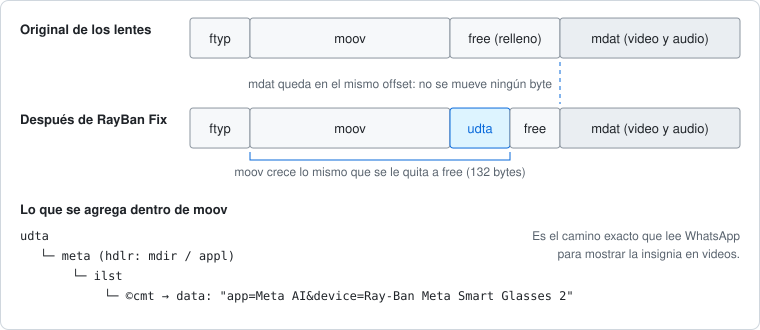

# RayBan Fix

Pon la insignia «Ray-Ban Meta» en los **videos** que publicas en tus estados de WhatsApp, igual que ya pasa con las fotos de los lentes.

La app no revisa de dónde salió el video: solo te pregunta con qué lentes lo grabaste. Y tú siempre dices la verdad, ¿no? 😉

Incluye dos formas de hacerlo:

- **App de Android** (`src/`, `res/`): elige un video o compártelo desde la galería con «Agregar etiqueta Ray-Ban Meta» y se reenvía ya arreglado. No necesita root.
- **Script de Python** (`python/`): arregla un archivo MP4 en la PC.

## El problema

Con una foto de los lentes, WhatsApp lee el `Model` del EXIF y muestra la insignia. Con un video no aparece nunca, para ningún espectador.

La causa (detalle en [docs/reporte_whatsapp_atribucion_video.md](docs/reporte_whatsapp_atribucion_video.md), analizado en WhatsApp 2.26.36.74): para los videos, WhatsApp recorre a mano las cajas del MP4 y solo busca este camino, al estilo clásico de iTunes:

```
moov → udta → meta (handler mdir/appl) → ilst → ©cmt → "…device=<modelo>…"
```

Los videos actuales de los lentes no traen esa caja `udta`. Guardan los mismos datos (`app=Meta AI&device=Ray-Ban Meta Smart Glasses 2`) con el esquema moderno `keys` + `ilst` indexado, que ese lector no entiende. Por eso la insignia nunca se activa.

## La solución

Se agrega al `moov` una caja `udta` con el comentario `©cmt` que WhatsApp espera. El espacio sale de la caja `free` que los lentes dejan justo después de `moov`, así que **no se mueve ni un byte de `mdat`** ni hay que tocar las tablas de offsets: el archivo queda del mismo tamaño y el video es idéntico.



Para videos que ya pasaron por WhatsApp, Instagram, Telegram u otra app (que borran los metadatos de los lentes y casi nunca dejan una caja `free`), la app reescribe el `moov`, mueve lo que va detrás y actualiza los offsets de cada pista (`stco`/`co64`). En ese caso el modelo de los lentes lo eliges tú.

## App de Android

### Instalarla

1. Descarga `RayBanFix-x.y.apk` de la página de [Releases](../../releases).
2. Ábrelo en el teléfono y permite instalar apps de esa fuente. Requiere Android 10 o superior.

### Usarla

**Desde la galería (lo más rápido):**

1. Abre un video de los lentes en Google Fotos o en la galería.
2. Compartir → **Agregar etiqueta Ray-Ban Meta**.
3. Se abre el menú de compartir con el video ya arreglado: elige WhatsApp → Mi estado.

**Desde la app:**

- **Elegir video**: arregla un video grabado con los lentes. Queda en la lista como acceso directo al original, para volver a compartirlo en un toque.
- **Agregar video de otra app**: para videos que ya no traen los metadatos de los lentes (los que pasaron por WhatsApp, Instagram, Telegram… o los que, digamos, *recuerdas* haber grabado con ellos). Eliges el modelo (por defecto `Ray-Ban Meta Smart Glasses 2`) y se los pone. La app te pedirá que lo uses solo con videos de tus lentes; es un sistema basado en la confianza.
- **Opciones → Guardar también una copia**: además del acceso directo, guarda el video arreglado en `Movies/RayBanFix`.

«Elegir video» solo acepta videos que todavía traen `device=…` de los lentes. Para todo lo demás está «Agregar video de otra app», donde el modelo lo pones tú.

### Compilarla

No usa Gradle: `build.ps1` llama directamente a `aapt2`, `javac`, `d8`, `zipalign` y `apksigner`.

Requisitos: Android SDK con `platforms/android-36` y `build-tools/37.0.0`, y un JDK (por defecto el `jbr` de Android Studio).

```powershell
.\build.ps1
# APK listo: build\RayBanFix.apk

# Con otras rutas o versión de build-tools:
$env:ANDROID_HOME = 'D:\Android\Sdk'; $env:BUILD_TOOLS = '36.0.0'; $env:JAVA_HOME = 'C:\jdk-21'
.\build.ps1
```

La primera vez crea una clave de firma local (`raybanfix.keystore`), que no se sube al repositorio.

## Script de Python

Necesita Python 3.8 o superior, sin dependencias.

```bash
python python/raybanmeta_whatsapp_video_fix.py entrada.mp4 salida.mp4
```

Salida de ejemplo:

```
OK: salida.mp4 escrito (5276 bytes, igual al original).
    mdat permanece en el offset 1172 sin cambios.
    Se agrego udta/meta/hdlr/ilst/©cmt con device='Ray-Ban Meta Smart Glasses 2' (132 bytes).
```

Con otro modelo de lentes, pásalo como tercer argumento:

```bash
python python/raybanmeta_whatsapp_video_fix.py entrada.mp4 salida.mp4 "Ray-Ban Meta Smart Glasses"
```

El script es la versión mínima del arreglo: no pregunta de dónde viene el video, pero necesita que tenga una caja `free` justo después de `moov` (los videos de los lentes la traen; muchos otros no) y comprueba al final que `mdat` no se movió. Si el script se queja de que falta esa caja, usa la app, que sí reacomoda el archivo.

## Privacidad y permisos

- La app **no usa internet**: no tiene el permiso `INTERNET` y todo el arreglo ocurre en el teléfono.
- Pide acceso a tus videos (`READ_MEDIA_VIDEO`, o acceso limitado a los que elijas) solo para guardar accesos directos al original y volver a compartirlo. Sin ese permiso funciona igual, pero los videos compartidos desde la galería no quedan en la lista.
- No modifica tus videos originales: comparte una copia arreglada (temporal, o guardada en `Movies/RayBanFix` si activas esa opción).
- Solo cambia metadatos: el video no se recodifica ni pierde calidad.

## Preguntas frecuentes

**¿Necesita root?** No. Es una app normal de Android 10 o superior.

**¿Sirve para fotos?** No hace falta: las fotos de los lentes ya muestran la insignia, porque WhatsApp las lee del EXIF.

**¿La insignia la ven todos?** Sí. Al publicar el video arreglado, la atribución viaja con el estado y la ven también los contactos que lo abren desde otro teléfono.

**¿Tiene que ser un video de los lentes?** La insignia la decide WhatsApp leyendo los metadatos del archivo, no mirando el video. Saca tus propias conclusiones.

**Compartí el video y no salió la insignia.** Si «Elegir video» lo rechazó o ya pasó por otra app, usa «Agregar video de otra app» y elige el modelo. Si se publicó el archivo original en vez del arreglado, comparte de nuevo desde la lista de la app.

**¿Qué pasa si WhatsApp corrige su lector?** El video arreglado sigue siendo un MP4 válido; la caja extra simplemente deja de hacer falta.

## Limitaciones

- Probado con la app Meta AI instalada y vinculada a unos lentes. Sin ella no está probado: en las fotos, WhatsApp consulta a esa app el estado de conexión de los lentes, y podría hacer lo mismo con los videos.
- MP4 fragmentado o de más de 4 GB: no soportado.
- Video de los lentes editado por otra app con el `moov` al final: no soportado en «Elegir video»; usa «Agregar video de otra app».
- Depende de cómo lee WhatsApp los metadatos; si cambia ese lector, el arreglo puede dejar de hacer falta o de funcionar.

## Estructura

- `src/com/elcesarmaat/raybanfix/`: `Mp4Patcher` (arreglo sin mover `mdat`), `StrippedVideoPatcher` (videos de otras apps), `FixActivity` (Compartir), `MainActivity` (lista y accesos directos).
- `res/`: interfaz (Material, tema claro y oscuro).
- `python/`: script de línea de comandos.
- `docs/`: reporte técnico del fallo de WhatsApp.

## Licencia

[MIT](LICENSE). Ray-Ban, Meta y WhatsApp son marcas de sus respectivos dueños; este proyecto no está afiliado a ellos.
